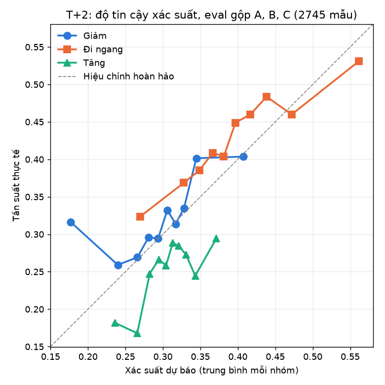
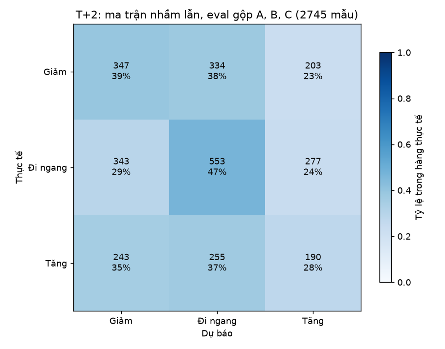
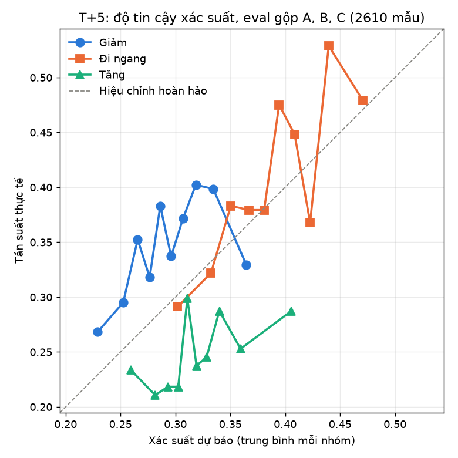
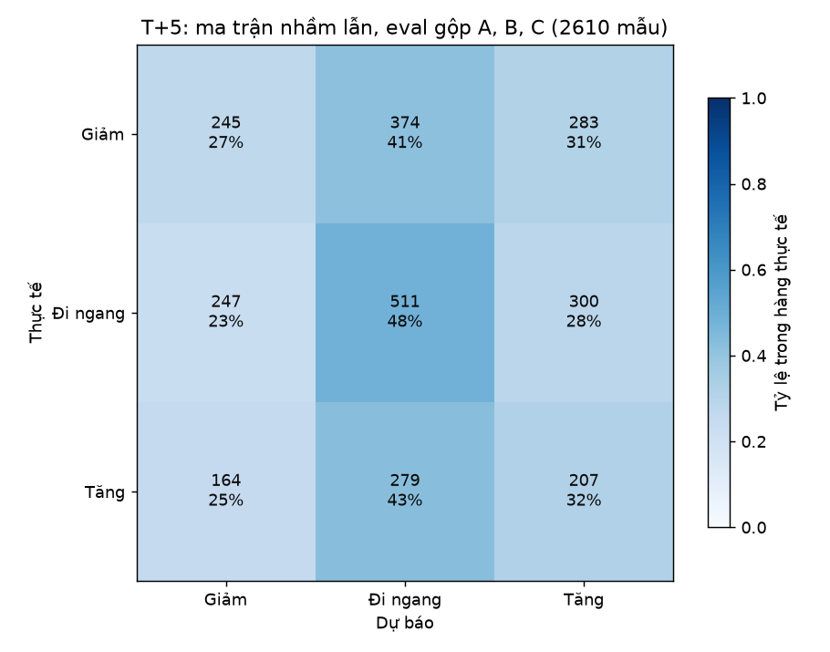

# Giải thích và khuyến nghị: model đa phương thức T+2, T+5

**Đây là vùng phát triển, chưa phải kết quả cuối.** Khối eval của fold A, B, C đã bị nhìn trong các thí nghiệm trước. Mọi đo lường ở đây dùng hàng eval; không có gì được fit trên eval: nhiệt độ và ngưỡng `m` từ calib, nền SHAP, phân phối LIME và `gbm_all` từ train.

**Giả định chưa xác nhận:** lợi suất tính theo thanh toán T+2 và không bán khống, chủ dự án chưa xác nhận giả định này. Lệnh chỉ LONG, mua ở giá mở cửa t+1, bán ở giá đóng cửa t+h+1, trừ phí 0.0045. Không tính trượt giá, kẹt trần sàn, hay giới hạn vốn; các lệnh của phiên liền nhau chồng lấn thời gian.

Dataset: 24251acc1a5695bdcc2c8e8e6b2527669eb84b6ece095d6f3a5e6a929f2ae4ad. Arm giải thích theo file khóa, dùng chung cho mọi fold của h: khóa là `stack` (không có trọng số) thì dùng `fusion_attention`.

|   h | fusion khóa      | arm giải thích   |
|----:|:-----------------|:-----------------|
|   2 | fusion_attention | fusion_attention |
|   5 | fusion_attention | fusion_attention |

## Kết luận theo h

**T+2** (fusion khóa fusion_attention). Theo luật: độ phủ 19.4%, 523 lệnh, 133 phiên, lợi suất ròng trung bình -0.0054 (CI 95% -0.0094 đến -0.0004), ngẫu nhiên cùng số lệnh -0.0080. Toàn mẫu: độ phủ 100%, 2700 lệnh, -0.0080. **Luật lỗ sau phí:** trung bình âm và cả CI nằm dưới 0, bằng chứng nghiêng về lỗ chứ không chỉ là thiếu bằng chứng. Cao hơn ngẫu nhiên chỉ có nghĩa là lỗ ít hơn. Không dùng nhãn "Ưu tiên mua" ra quyết định.

Fold có CI nằm hẳn dưới 0: B (-0.0062, độ phủ 30.9%, 278 lệnh). Fold kém hơn ngẫu nhiên: C (-0.0085, độ phủ 8.8%, 79 lệnh, ngẫu nhiên -0.0050).

Nhóm làm log-loss tăng khi hoán vị (lo > 0 ở ít nhất 2/3 fold; một seed, CI chưa hiệu chỉnh đa so sánh): không có. Tỷ trọng SHAP trung bình: price 76%, text 19%, fund 5%.

**T+5** (fusion khóa fusion_attention). Theo luật: độ phủ 9.8%, 252 lệnh, 57 phiên, lợi suất ròng trung bình -0.0046 (CI 95% -0.0239 đến +0.0294), ngẫu nhiên cùng số lệnh -0.0111. Toàn mẫu: độ phủ 100%, 2565 lệnh, -0.0111. **Luật không có lãi:** trung bình âm, CI chứa 0. Cao hơn ngẫu nhiên chỉ có nghĩa là lỗ ít hơn. Không dùng nhãn "Ưu tiên mua" ra quyết định.

Fold có CI nằm hẳn dưới 0: không có. Fold kém hơn ngẫu nhiên: C (-0.0196, độ phủ 2.7%, 23 lệnh, ngẫu nhiên -0.0039).

Nhóm làm log-loss tăng khi hoán vị (lo > 0 ở ít nhất 2/3 fold; một seed, CI chưa hiệu chỉnh đa so sánh): fund (A +0.0014, B +0.0024, C +0.0043). Tỷ trọng SHAP trung bình: price 66%, text 24%, fund 10%.

## Luật khuyến nghị

- **Ưu tiên mua**: `p_up - p_down >= m`.
- **Tránh**: `p_down - p_up >= m`.
- **Không đủ tin cậy**: còn lại.

`m` chọn trên calib của từng fold từ xác suất ensemble (trung bình 5 seed), lấy trung bình lợi suất ròng cao nhất với ít nhất 50 lệnh; không có `m` đạt thì không có lệnh. Lệnh có phiên bán t+h+1 vượt cuối khối bị bỏ khỏi cả việc chọn `m` lẫn mô phỏng (các hàng ở phiên có t+h trùng cuối khối), nên calib không đọc giá của eval và eval không đọc giá sau khối.

Luật không đòi calib dương: `m` tốt nhất có trung bình calib âm thì luật vẫn giao dịch và kết quả vẫn được tính. Các ô có trung bình calib âm: h2 B (-0.0024, độ phủ calib 34.4%, 310 lệnh), h2 C (-0.0034, độ phủ calib 9.1%, 82 lệnh).

## Kết quả mô phỏng kèm độ phủ

`coverage` (độ phủ) là tỷ lệ hàng eval có lợi suất được gắn "Ưu tiên mua". `toàn mẫu` là mua mọi hàng, để so sánh. `gộp` nối eval của ba fold, mỗi fold giữ `m` của nó. `rand_median` là trung vị của 1000 lần rút ngẫu nhiên cùng số lệnh. CI 95% theo block bootstrap phiên. `calib_mean_net`, `calib_coverage`, `calib_n` là lợi suất ròng trung bình, độ phủ và số lệnh trên calib tại `m` đã chọn: đó là số dùng để chọn `m`, không phải kết quả ngoài mẫu. Độ phủ thấp nghĩa là kết quả chỉ nói về phần nhỏ đó; `n` dưới khoảng 30 thì CI gần như không đọc được.

|   h | fold   | pham_vi   |        m |   coverage |    n |   n_days |   mean_net |   ci_lo |   ci_hi |   rand_median |   share_tranh |   share_khong_du |   calib_mean_net |   calib_coverage |   calib_n |
|----:|:-------|:----------|---------:|-----------:|-----:|---------:|-----------:|--------:|--------:|--------------:|--------------:|-----------------:|-----------------:|-----------------:|----------:|
|   2 | A      | theo luật |   0.0400 |     0.1844 |  166 |       48 |    -0.0026 | -0.0121 |  0.0049 |       -0.0082 |        0.0022 |           0.8133 |           0.0040 |           0.1022 |        92 |
|   2 | A      | toàn mẫu  | nan      |     1.0000 |  900 |       60 |    -0.0083 | -0.0178 |  0.0003 |       -0.0083 |      nan      |         nan      |         nan      |         nan      |           |
|   2 | B      | theo luật |   0.0600 |     0.3089 |  278 |       47 |    -0.0062 | -0.0086 | -0.0028 |       -0.0107 |        0.2189 |           0.4722 |          -0.0024 |           0.3444 |       310 |
|   2 | B      | toàn mẫu  | nan      |     1.0000 |  900 |       60 |    -0.0107 | -0.0158 | -0.0065 |       -0.0107 |      nan      |         nan      |         nan      |         nan      |           |
|   2 | C      | theo luật |   0.0800 |     0.0878 |   79 |       38 |    -0.0085 | -0.0168 |  0.0052 |       -0.0050 |        0.0356 |           0.8767 |          -0.0034 |           0.0911 |        82 |
|   2 | C      | toàn mẫu  | nan      |     1.0000 |  900 |       60 |    -0.0050 | -0.0107 | -0.0000 |       -0.0050 |      nan      |         nan      |         nan      |         nan      |           |
|   2 | gộp    | theo luật | nan      |     0.1937 |  523 |      133 |    -0.0054 | -0.0094 | -0.0004 |       -0.0080 |        0.0856 |           0.7207 |         nan      |         nan      |           |
|   2 | gộp    | toàn mẫu  | nan      |     1.0000 | 2700 |      180 |    -0.0080 | -0.0124 | -0.0040 |       -0.0080 |      nan      |         nan      |         nan      |         nan      |           |
|   5 | A      | theo luật |   0.1000 |     0.2655 |  227 |       40 |    -0.0034 | -0.0208 |  0.0424 |       -0.0113 |        0.0199 |           0.7146 |           0.0209 |           0.1181 |       101 |
|   5 | A      | toàn mẫu  | nan      |     1.0000 |  855 |       57 |    -0.0115 | -0.0326 |  0.0080 |       -0.0115 |      nan      |         nan      |         nan      |         nan      |           |
|   5 | B      | theo luật |   0.1200 |     0.0023 |    2 |        1 |     0.0258 |  0.0258 |  0.0258 |       -0.0167 |        0.0000 |           0.9977 |           0.0057 |           0.0620 |        53 |
|   5 | B      | toàn mẫu  | nan      |     1.0000 |  855 |       57 |    -0.0178 | -0.0299 | -0.0076 |       -0.0178 |      nan      |         nan      |         nan      |         nan      |           |
|   5 | C      | theo luật |   0.0800 |     0.0269 |   23 |       16 |    -0.0196 | -0.0399 |  0.0098 |       -0.0039 |        0.0830 |           0.8901 |           0.0041 |           0.0678 |        58 |
|   5 | C      | toàn mẫu  | nan      |     1.0000 |  855 |       57 |    -0.0041 | -0.0166 |  0.0065 |       -0.0041 |      nan      |         nan      |         nan      |         nan      |           |
|   5 | gộp    | theo luật | nan      |     0.0982 |  252 |       57 |    -0.0046 | -0.0239 |  0.0294 |       -0.0111 |        0.0343 |           0.8674 |         nan      |         nan      |           |
|   5 | gộp    | toàn mẫu  | nan      |     1.0000 | 2565 |      171 |    -0.0111 | -0.0207 | -0.0027 |       -0.0111 |      nan      |         nan      |         nan      |         nan      |           |

## Trọng số attention theo nhánh

Trọng số attention của `fusion_attention` seed 59 (`net.last_weights`), trung bình trên hàng eval. Trọng số cho biết model chú ý nhánh nào, không chứng minh nhánh đó giúp dự báo.

|   h | fold   |   price |   fund |   text |
|----:|:-------|--------:|-------:|-------:|
|   2 | A      |  0.4390 | 0.2233 | 0.3377 |
|   2 | B      |  0.4123 | 0.2915 | 0.2962 |
|   2 | C      |  0.5190 | 0.1693 | 0.3118 |
|   5 | A      |  0.6806 | 0.1105 | 0.2088 |
|   5 | B      |  0.3409 | 0.3300 | 0.3292 |
|   5 | C      |  0.4361 | 0.2241 | 0.3398 |

## Permutation theo nhóm

Log-loss seed 59 đã hiệu chỉnh nhiệt độ, sau hoán vị trừ trước hoán vị, trung bình 5 lần hoán vị; dương là nhóm có ích. Vector của nhóm được hoán vị giữa các mã trong cùng phiên, nên phần thông tin chung cả thị trường trong phiên không bị phá: bảng chỉ đo khả năng phân biệt giữa các mã. Các CI chưa hiệu chỉnh đa so sánh.

|   h | fold   | group   |   delta_logloss |      lo |      hi |
|----:|:-------|:--------|----------------:|--------:|--------:|
|   2 | A      | price   |          0.0120 |  0.0067 |  0.0183 |
|   2 | A      | fund    |          0.0005 | -0.0007 |  0.0016 |
|   2 | A      | text    |         -0.0000 | -0.0022 |  0.0021 |
|   2 | B      | price   |          0.0147 | -0.0041 |  0.0348 |
|   2 | B      | fund    |         -0.0020 | -0.0058 |  0.0011 |
|   2 | B      | text    |         -0.0001 | -0.0039 |  0.0037 |
|   2 | C      | price   |          0.0036 | -0.0015 |  0.0080 |
|   2 | C      | fund    |          0.0018 | -0.0008 |  0.0046 |
|   2 | C      | text    |         -0.0019 | -0.0044 |  0.0008 |
|   5 | A      | price   |          0.0078 |  0.0012 |  0.0149 |
|   5 | A      | fund    |          0.0014 |  0.0001 |  0.0026 |
|   5 | A      | text    |         -0.0009 | -0.0023 |  0.0005 |
|   5 | B      | price   |          0.0018 | -0.0055 |  0.0104 |
|   5 | B      | fund    |          0.0024 | -0.0006 |  0.0063 |
|   5 | B      | text    |          0.0002 | -0.0013 |  0.0016 |
|   5 | C      | price   |          0.0007 | -0.0039 |  0.0070 |
|   5 | C      | fund    |          0.0043 |  0.0022 |  0.0062 |
|   5 | C      | text    |         -0.0061 | -0.0116 | -0.0001 |

## Tỷ trọng SHAP theo nhóm và lớp

`GradientExplainer` trên logit của seed 59, CPU, 200 mẫu nền từ train, 500 mẫu từ eval. |SHAP| cộng qua thời gian và đặc trưng rồi chia tổng ba nhóm; phần của embedding mã không tính. Nhóm giá có nhiều ô hơn hẳn (cửa sổ 60 phiên), nên tỷ trọng không chuẩn hóa theo số đặc trưng và không phải mức đóng góp vào độ chính xác.

|   h | fold   | class   | group   |   mean_abs_shap |   share |
|----:|:-------|:--------|:--------|----------------:|--------:|
|   2 | A      | down    | price   |          0.9144 |  0.7127 |
|   2 | A      | flat    | price   |          0.9562 |  0.7314 |
|   2 | A      | up      | price   |          0.5865 |  0.6882 |
|   2 | A      | down    | fund    |          0.0801 |  0.0624 |
|   2 | A      | flat    | fund    |          0.0801 |  0.0613 |
|   2 | A      | up      | fund    |          0.0682 |  0.0800 |
|   2 | A      | down    | text    |          0.2885 |  0.2249 |
|   2 | A      | flat    | text    |          0.2710 |  0.2073 |
|   2 | A      | up      | text    |          0.1975 |  0.2318 |
|   2 | B      | down    | price   |          2.9158 |  0.9002 |
|   2 | B      | flat    | price   |          1.8139 |  0.8901 |
|   2 | B      | up      | price   |          2.4354 |  0.8690 |
|   2 | B      | down    | fund    |          0.0922 |  0.0285 |
|   2 | B      | flat    | fund    |          0.0641 |  0.0315 |
|   2 | B      | up      | fund    |          0.0869 |  0.0310 |
|   2 | B      | down    | text    |          0.2309 |  0.0713 |
|   2 | B      | flat    | text    |          0.1598 |  0.0784 |
|   2 | B      | up      | text    |          0.2803 |  0.1000 |
|   2 | C      | down    | price   |          1.3405 |  0.7135 |
|   2 | C      | flat    | price   |          0.9122 |  0.7102 |
|   2 | C      | up      | price   |          0.5734 |  0.5858 |
|   2 | C      | down    | fund    |          0.1038 |  0.0553 |
|   2 | C      | flat    | fund    |          0.0711 |  0.0554 |
|   2 | C      | up      | fund    |          0.0694 |  0.0709 |
|   2 | C      | down    | text    |          0.4344 |  0.2312 |
|   2 | C      | flat    | text    |          0.3012 |  0.2345 |
|   2 | C      | up      | text    |          0.3360 |  0.3433 |
|   5 | A      | down    | price   |          6.2440 |  0.8558 |
|   5 | A      | flat    | price   |          1.1673 |  0.8789 |
|   5 | A      | up      | price   |          2.8362 |  0.8062 |
|   5 | A      | down    | fund    |          0.1760 |  0.0241 |
|   5 | A      | flat    | fund    |          0.0319 |  0.0240 |
|   5 | A      | up      | fund    |          0.1254 |  0.0357 |
|   5 | A      | down    | text    |          0.8758 |  0.1200 |
|   5 | A      | flat    | text    |          0.1290 |  0.0971 |
|   5 | A      | up      | text    |          0.5563 |  0.1581 |
|   5 | B      | down    | price   |          0.3616 |  0.6109 |
|   5 | B      | flat    | price   |          0.2671 |  0.6001 |
|   5 | B      | up      | price   |          0.2743 |  0.5475 |
|   5 | B      | down    | fund    |          0.1137 |  0.1921 |
|   5 | B      | flat    | fund    |          0.0644 |  0.1448 |
|   5 | B      | up      | fund    |          0.0928 |  0.1852 |
|   5 | B      | down    | text    |          0.1166 |  0.1969 |
|   5 | B      | flat    | text    |          0.1136 |  0.2552 |
|   5 | B      | up      | text    |          0.1339 |  0.2673 |
|   5 | C      | down    | price   |          0.6775 |  0.4537 |
|   5 | C      | flat    | price   |          0.7994 |  0.6846 |
|   5 | C      | up      | price   |          0.5966 |  0.5169 |
|   5 | C      | down    | fund    |          0.1163 |  0.0779 |
|   5 | C      | flat    | fund    |          0.0845 |  0.0724 |
|   5 | C      | up      | fund    |          0.1366 |  0.1184 |
|   5 | C      | down    | text    |          0.6994 |  0.4684 |
|   5 | C      | flat    | text    |          0.2838 |  0.2430 |
|   5 | C      | up      | text    |          0.4210 |  0.3647 |

## Ba ca LIME mỗi (h, fold)

`gbm_all` refit trên train. Ba hàng eval chọn theo xác suất của chính model, không theo kết quả. Trọng số giải thích lớp được dự báo; dương là đẩy về lớp đó. Ngưỡng trong tên đặc trưng là giá trị đã chuẩn hóa theo train.

|   h | fold   | ca                     | symbol   | phiên      | dự báo   |     p | thực tế   | đặc trưng                                                                                                                                                                   |
|----:|:-------|:-----------------------|:---------|:-----------|:---------|------:|:----------|:----------------------------------------------------------------------------------------------------------------------------------------------------------------------------|
|   2 | A      | p_up - p_down lớn nhất | GAS      | 2026-03-10 | Tăng     | 0.865 | Đi ngang  | std_60 > 0.60 (-0.029); std_ratio_20_60 > 0.70 (+0.025); d_ma20 <= -0.48 (+0.023); ret_2 <= -0.45 (+0.023); ret_60 > 0.54 (+0.021)                                          |
|   2 | A      | p_down - p_up lớn nhất | MWG      | 2026-03-11 | Giảm     | 0.593 | Giảm      | std_60 > 0.60 (-0.070); close_loc > 0.87 (+0.045); std_ratio_20_60 > 0.70 (+0.033); mret5 <= -0.53 (+0.033); h_l > 0.35 (+0.030)                                            |
|   2 | A      | gần nhau nhất          | FPT      | 2026-02-13 | Đi ngang | 0.403 | Giảm      | -0.03 < std_ratio_20_60 <= 0.70 (-0.037); mret5 > 0.59 (+0.027); d_ma20 <= -0.48 (-0.025); -0.40 < mret1 <= 0.06 (-0.022); -0.77 < std_60 <= -0.17 (-0.021)                 |
|   2 | B      | p_up - p_down lớn nhất | VRE      | 2026-05-11 | Tăng     | 0.657 | Đi ngang  | std_60 > 0.60 (-0.031); ret_60 > 0.53 (+0.029); ret_1 <= -0.44 (-0.028); ret_2 <= -0.45 (+0.026); -0.03 < std_ratio_20_60 <= 0.71 (+0.026)                                  |
|   2 | B      | p_down - p_up lớn nhất | VIC      | 2026-06-11 | Giảm     | 0.506 | Đi ngang  | std_60 > 0.60 (-0.061); std_ratio_20_60 <= -0.74 (-0.051); close_loc > 0.88 (+0.038); o_pc <= -0.25 (+0.028); -0.29 < h_l <= 0.36 (+0.021)                                  |
|   2 | B      | gần nhau nhất          | VCB      | 2026-05-22 | Đi ngang | 0.443 | Tăng      | -0.03 < std_ratio_20_60 <= 0.71 (-0.035); -0.16 < std_60 <= 0.60 (+0.032); mret5 <= -0.53 (-0.023); -0.76 < mvol20 <= -0.32 (+0.019); -0.53 < ret_60 <= -0.02 (+0.017)      |
|   2 | C      | p_up - p_down lớn nhất | TCB      | 2026-08-26 | Tăng     | 0.563 | Đi ngang  | close_loc > 0.88 (-0.040); std_ratio_20_60 > 0.70 (+0.022); ret_2 > 0.47 (-0.021); mret1 > 0.50 (+0.020); ret_20 > 0.52 (-0.019)                                            |
|   2 | C      | p_down - p_up lớn nhất | MSN      | 2026-10-19 | Giảm     | 0.662 | Tăng      | close_loc > 0.88 (+0.038); ret_20 > 0.52 (+0.028); ret_2 > 0.47 (+0.027); std_ratio_20_60 > 0.70 (+0.023); ep <= -0.56 (+0.021)                                             |
|   2 | C      | gần nhau nhất          | MWG      | 2026-08-07 | Đi ngang | 0.430 | Tăng      | std_ratio_20_60 > 0.70 (-0.053); -0.15 < std_60 <= 0.60 (+0.032); downside_20 > 0.52 (+0.024); -0.49 < d_ma20 <= -0.03 (+0.018); eps_yoy > 0.26 (-0.015)                    |
|   5 | A      | p_up - p_down lớn nhất | VIC      | 2026-03-09 | Tăng     | 0.826 | Đi ngang  | d_ma20 <= -0.48 (+0.037); ret_60 > 0.54 (+0.037); ep <= -0.56 (-0.033); std_10 > 0.47 (+0.027); std_60 > 0.60 (-0.023)                                                      |
|   5 | A      | p_down - p_up lớn nhất | GAS      | 2026-01-26 | Giảm     | 0.749 | Tăng      | std_60 > 0.60 (-0.075); close_loc > 0.87 (+0.062); std_ratio_20_60 > 0.70 (+0.051); mret5 <= -0.53 (+0.038); o_pc <= -0.24 (+0.034)                                         |
|   5 | A      | gần nhau nhất          | MBB      | 2026-04-13 | Đi ngang | 0.523 | Đi ngang  | -0.17 < std_60 <= 0.60 (+0.042); mret5 > 0.59 (+0.025); o_pc <= -0.24 (-0.023); -0.50 < ret_60 <= 0.02 (+0.019); -0.74 < std_ratio_20_60 <= -0.03 (+0.019)                  |
|   5 | B      | p_up - p_down lớn nhất | VRE      | 2026-05-11 | Tăng     | 0.552 | Đi ngang  | ret_60 > 0.53 (+0.043); d_ma20 > 0.50 (-0.039); std_60 > 0.59 (-0.021); mvol20 <= -0.76 (+0.019); -0.31 < ep <= 0.20 (+0.018)                                               |
|   5 | B      | p_down - p_up lớn nhất | VNM      | 2026-07-21 | Giảm     | 0.696 | Tăng      | std_60 <= -0.77 (+0.065); std_ratio_20_60 > 0.71 (+0.040); o_pc <= -0.25 (+0.032); -0.56 < ep <= -0.31 (+0.030); mret5 <= -0.53 (+0.026)                                    |
|   5 | B      | gần nhau nhất          | SSI      | 2026-06-18 | Đi ngang | 0.435 | Giảm      | -0.16 < std_60 <= 0.59 (+0.051); -0.01 < ret_60 <= 0.53 (+0.023); -0.74 < std_ratio_20_60 <= -0.03 (+0.017); -0.46 < ret_2 <= -0.02 (-0.014); 0.09 < mret5 <= 0.59 (+0.014) |
|   5 | C      | p_up - p_down lớn nhất | ACB      | 2026-08-21 | Tăng     | 0.523 | Đi ngang  | -0.25 < mvol20 <= 0.42 (+0.032); close_loc > 0.88 (-0.025); -0.03 < ret_60 <= 0.50 (-0.021); -0.72 < roe <= 0.19 (+0.016); -0.77 < std_20 <= -0.23 (+0.014)                 |
|   5 | C      | p_down - p_up lớn nhất | VCB      | 2026-10-19 | Giảm     | 0.578 | Đi ngang  | std_60 <= -0.78 (+0.058); std_ratio_20_60 <= -0.74 (-0.043); mvol20 <= -0.78 (-0.038); -0.56 < ep <= -0.31 (+0.022); close_loc <= -0.94 (-0.020)                            |
|   5 | C      | gần nhau nhất          | MWG      | 2026-10-08 | Đi ngang | 0.579 | Giảm      | std_ratio_20_60 <= -0.74 (+0.054); -0.15 < std_60 <= 0.60 (+0.053); d_ma20 > 0.49 (+0.049); -0.03 < ret_60 <= 0.50 (+0.018); 0.19 < roe <= 0.79 (+0.017)                    |

## Độ tin cậy xác suất và ma trận nhầm lẫn

Xác suất ensemble của fusion khóa trên eval gộp. Ma trận dùng lớp quyết định theo alpha và prior của từng fold.

Hiệu chỉnh chưa đúng trên eval: p_up bị đánh giá cao (xem hình reliability), và điều này làm `p_up - p_down` rộng ra đúng về phía luật mua, nên `m` không đọc được như một mức tin cậy thật.

- T+2, toàn eval: p_up 0.306, tần suất Tăng 0.251; p_down 0.296, tần suất Giảm 0.322. 523 lệnh của luật: p_up 0.320, tần suất Tăng 0.228; p_down 0.232, tần suất Giảm 0.252.
- T+5, toàn eval: p_up 0.320, tần suất Tăng 0.249; p_down 0.293, tần suất Giảm 0.346. 252 lệnh của luật: p_up 0.398, tần suất Tăng 0.298; p_down 0.249, tần suất Giảm 0.270.

